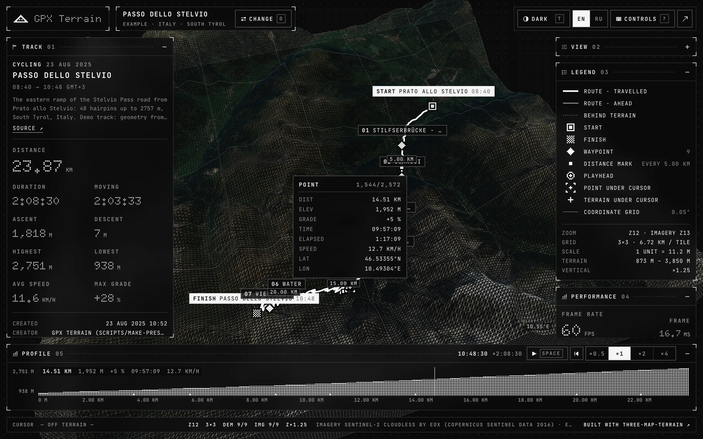
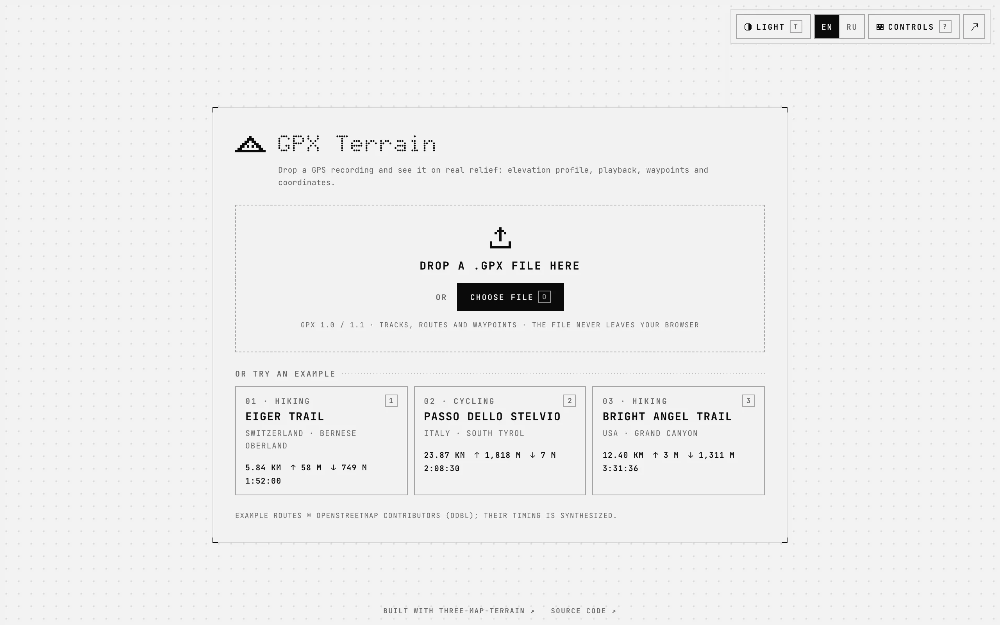
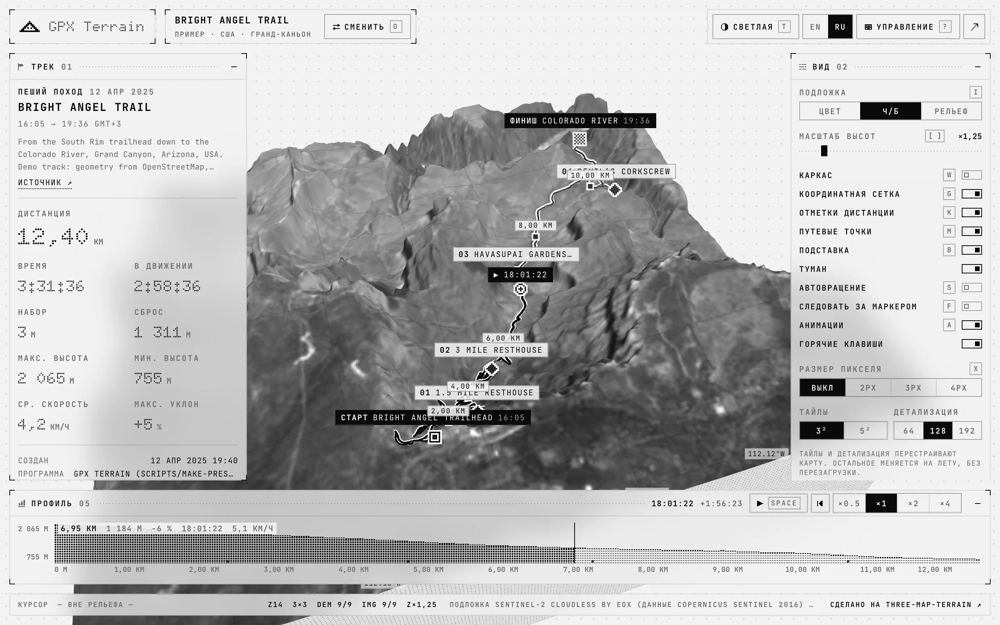
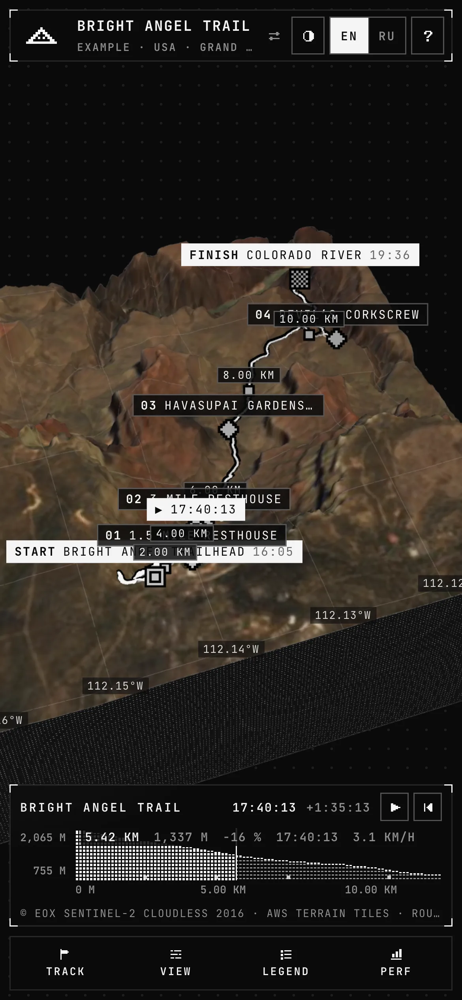

<div align="center">

# GPX Terrain

**See a GPS track on real 3D terrain.**<br>
Elevation profile, playback, waypoints and coordinates — in English and Russian, installable, and offline for what you have seen.

[](https://github.com/whidrubeld/gpx-terrain/actions/workflows/ci.yml)
[](https://github.com/whidrubeld/three-map-terrain)
[](LICENSE)

[**Open GPX Terrain**](https://whidrubeld.github.io/gpx-terrain/) · [Features](#features) · [Development](#development) · [Built with three-map-terrain](#built-with-three-map-terrain)

<a href="https://whidrubeld.github.io/gpx-terrain/"></a>

</div>

## Features

- **Any GPX file** — tracks, routes and waypoints, GPX 1.0 and 1.1, heart rate from Garmin-style extensions. Drop a file anywhere, pick one, or start with one of three example routes. Files never leave the browser.
- **Real relief, four styles** — the terrain grid is fitted to the track, heights are true to scale with adjustable exaggeration. The Sentinel-2 photo with 3D buildings, the photo in gray, a colored model, or lines with every feature in a color of its own.
- **Buildings, roads, water and vegetation** — from OpenStreetMap, standing and lying on the terrain; each style shows what suits it (on the photo only the buildings it lacks), and you choose per style.
- **Profile and playback** — scrub the elevation profile, play the track back at four speeds with the camera following, inspect any point under the cursor.
- **English and Russian** — taken from the browser's languages until you pick one next to the theme switch; numbers, dates and units follow the language.
- **Installable, works offline** — a PWA: the app, its fonts and the examples are cached on install, terrain, imagery and map features as you view them. The installed app opens `.gpx` files from the system (Chromium browsers).
- **Keyboard first** — single-key shortcuts like other map viewers (they can be switched off), <kbd>⌘</kbd> <kbd>O</kbd> / <kbd>Ctrl</kbd> <kbd>O</kbd> to open a file, <kbd>?</kbd> for all of them.
- **Phones too** — a compact layout: the scene in the middle, panels in one bottom sheet.

<table>
  <tr>
    <td width="38%"></td>
    <td width="38%"></td>
    <td width="24%"></td>
  </tr>
  <tr>
    <td><sub>Start: a file or an example</sub></td>
    <td><sub>Grayscale imagery, light theme, Russian</sub></td>
    <td><sub>Phones</sub></td>
  </tr>
</table>

## Development

Node 24, pnpm (the version in `packageManager`).

```bash
pnpm install        # install
pnpm dev            # http://localhost:5173
pnpm test           # unit tests: GPX parsing, track stats, terrain fit, i18n, formats, hotkeys, settings
pnpm test:e2e       # Playwright against the production build (first: pnpm exec playwright install chromium)
pnpm build          # type-check + static build into dist/ (relative paths), with the service worker
pnpm validate       # lint + format check + unit tests + build
```

The service worker only exists in production builds: check PWA behavior with
`pnpm build && pnpm preview`. Pushing to `master` deploys `dist/` to GitHub
Pages ([deploy.yml](.github/workflows/deploy.yml)).

Other scripts: `pnpm presets` regenerates the example tracks (below),
`pnpm icons` the app icons from the pixel logo, and `pnpm screenshots` the
images in `docs/` from a running `pnpm dev` (Google Chrome and `cwebp`).

Architecture, conventions and the checks to run are in [AGENTS.md](AGENTS.md).

## Built with three-map-terrain

GPX Terrain is the showcase of [three-map-terrain](https://github.com/whidrubeld/three-map-terrain): 3D terrain for three.js from slippy-map tiles.

| Feature                         | API                                                                          | Where                                                                      |
| ------------------------------- | ---------------------------------------------------------------------------- | -------------------------------------------------------------------------- |
| Terrain grid around the track   | `new Map({ source, location, options })`, `map.init()`                       | [Terrain.tsx](src/scene/Terrain.tsx)                                       |
| Zoom that fits the track        | `Utils.position2tileFraction`, true-scale `zScale`                           | [fit.ts](src/lib/fit.ts)                                                   |
| Track draped on the surface     | `map.getTerrainPositionSync`                                                 | [drape.ts](src/scene/drape.ts)                                             |
| Terrain under the cursor        | `map.pick(raycaster)`                                                        | [Probes.tsx](src/scene/Probes.tsx)                                         |
| Styles at runtime               | `material.create`, `process` (gray photo), `map.setMaterial()`               | [Terrain.tsx](src/scene/Terrain.tsx), [look.ts](src/scene/look.ts)         |
| Buildings, roads, water, plants | `Buildings`, `Roads`, `Water`, `Vegetation` on OpenFreeMap, `map.addLayer()` | [layers.ts](src/scene/layers.ts)                                           |
| The "diorama" block and grid    | `TerrainBase`, `map.getLocation`                                             | [layers.ts](src/scene/layers.ts), [Graticule.tsx](src/scene/Graticule.tsx) |
| Elevations for tracks without   | `getTerrainPositionSync(...).z / zScale`                                     | [World.tsx](src/scene/World.tsx)                                           |

Vertical exaggeration is `scale.z` of the group holding the terrain and
everything on it, so it is free to change. A tile request that stalls does not
hold the intro back: after 25 s the viewer starts with the tiles it has and
refreshes once `map.init()` resolves.

React 19, [React Three Fiber](https://r3f.docs.pmnd.rs), [TanStack Store](https://tanstack.com/store), Tailwind CSS 4, Vite, [vite-plugin-pwa](https://vite-pwa-org.netlify.app) with Workbox. Fonts: Doto and JetBrains Mono. No UI kit: plain elements and pixel icons.

## Languages

Every visible string lives in [`src/i18n/locales/`](src/i18n/locales): `en.json`
defines the keys, TypeScript rejects a locale that misses one, and the tests
check placeholders and plural forms. To add a language:

1. Copy `en.json` to `<code>.json` and translate it (plural messages need
   every form of `Intl.PluralRules` for the language).
2. Add the code to `LOCALES` in [`locales.ts`](src/i18n/locales.ts), to
   `MESSAGES` in [`i18n/index.ts`](src/i18n/index.ts), to `TAGS` in
   [`format.ts`](src/lib/format.ts) and to the list in the inline script of
   [`index.html`](index.html).

The dot-matrix face (Doto) has no Cyrillic: Russian headings in it fall back
to JetBrains Mono.

## Example tracks

`public/presets/*.gpx` are generated by `pnpm presets`
([scripts/make-presets.mjs](scripts/make-presets.mjs)): the route geometry is
the shortest path through the ways of an OpenStreetMap route, or through the
streets of a city by way of a few places (Overpass API), elevations come from
the same terrarium tiles the map uses, smoothed like a barometric altimeter,
and the timestamps are **synthesized** (Tobler's hiking function, a
constant-power cycling model, Minetti's energy cost of running) with GPS
jitter and rest stops. They
are not real recordings, and their metadata says so. The chooser shows their
stats before loading them ([presets.ts](src/gpx/presets.ts)); a unit test
keeps the two in sync.

## Privacy

Files are read in the browser and never uploaded. The only requests go to the
tile servers below, for the area of the track.

## Data and attribution

- Imagery: [Sentinel-2 cloudless](https://s2maps.eu) by EOX IT Services GmbH
  (contains modified Copernicus Sentinel data 2016), CC BY-NC-SA 4.0
- Elevation: [AWS Terrain Tiles](https://registry.opendata.aws/terrain-tiles/)
- Buildings, roads, water and vegetation: [OpenFreeMap](https://openfreemap.org)
  © [OpenMapTiles](https://www.openmaptiles.org) © [OpenStreetMap](https://www.openstreetmap.org/copyright)
  contributors, ODbL
- Example routes: © [OpenStreetMap](https://www.openstreetmap.org/copyright) contributors, ODbL

## License

[MIT](LICENSE)
